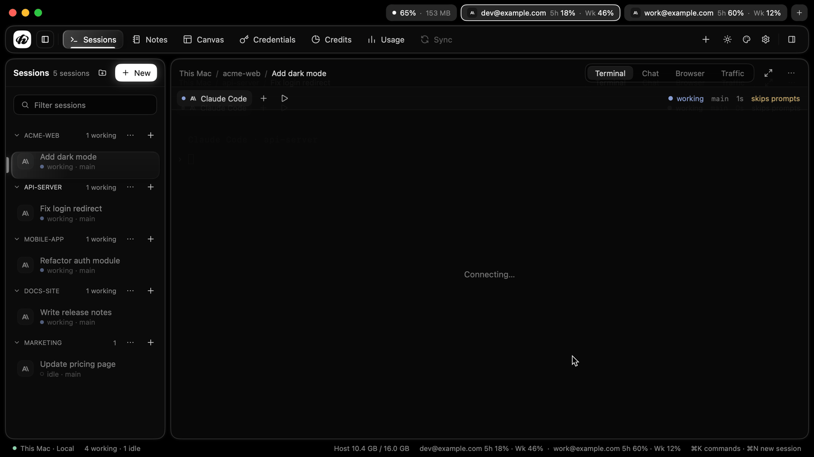
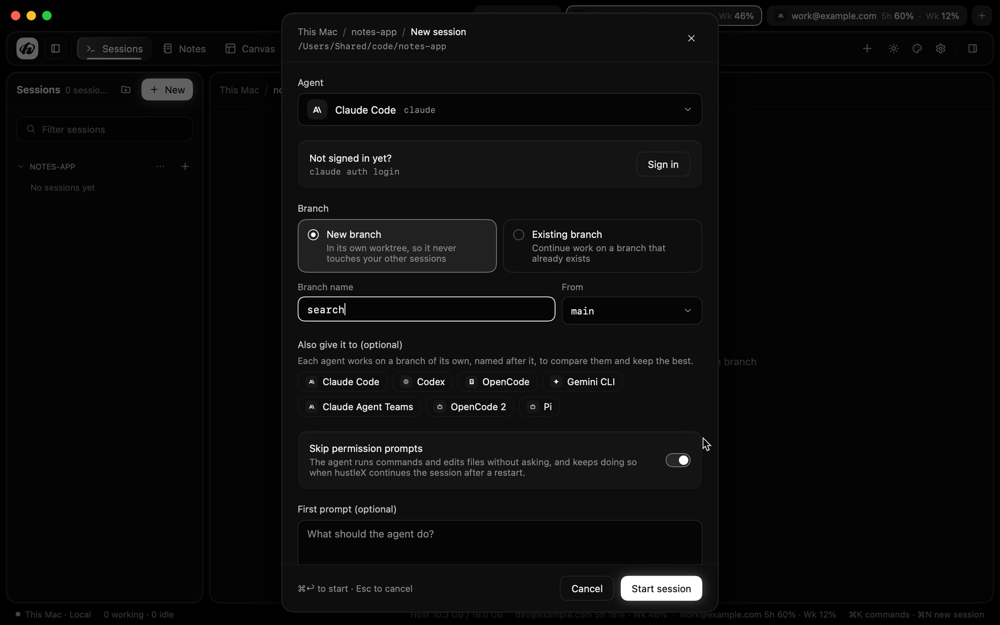
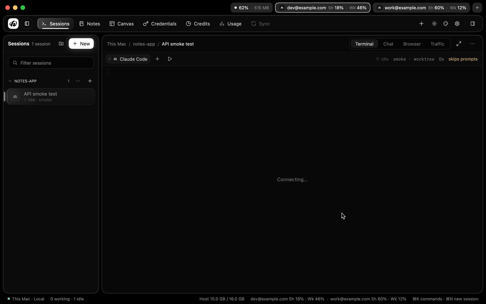
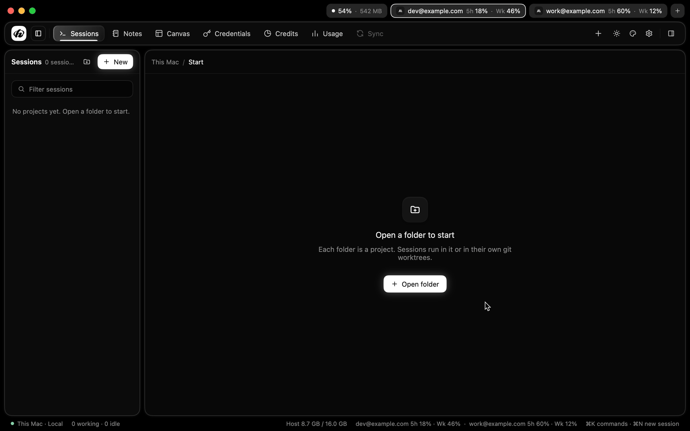
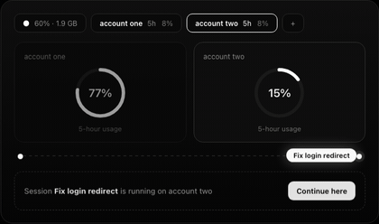

<p align="center">
  
</p>

<h1 align="center">hustleX</h1>

<p align="center">
  Run Claude Code, Codex and other coding agents side by side, each on its own git branch,<br>
  on your laptop or on your own server. No cloud, no account, no telemetry.
</p>

<p align="center">
  <a href="https://github.com/hustle-x/hustlex/releases/latest"></a>
  
  
  <a href="LICENSE"></a>
</p>

<p align="center">
  
  
  
  <a href="https://github.com/hustle-x/hustlex/stargazers"></a>
</p>

<p align="center">
  <a href="https://hustle-x.github.io/hustlex/">Website</a> ·
  <a href="https://github.com/hustle-x/hustlex/releases/latest">Download</a> ·
  <a href="docs/install.md">Install</a> ·
  <a href="docs/agents.md">Agents</a> ·
  <a href="docs/cli.md">Command line</a> ·
  <a href="#license">License</a>
</p>

<p align="center">
  
</p>

<p align="center"><sub>Every image on this page uses sample data.</sub></p>

## What it does

- **Parallel sessions.** Each session is an agent in a real terminal, on its own branch and its own git worktree. Agents never overwrite each other or your checkout.
- **Compare.** Send one prompt to several agents, look at what each one changed, keep the best and drop the rest.
- **Review and ship.** See a session's diff, send comments back to the agent, then commit, push, open a pull request or merge. A warning shows when two sessions touch the same lines.
- **Terminal or chat.** Claude Code and Codex can also be read as a chat, with tool calls and diffs folded in.
- **Your own servers.** Connect over SSH or Tailscale. Sessions keep running when the laptop is closed, and a blank server can be set up in one step.
- **Accounts and usage.** Use several accounts of the same agent and keep an eye on each one's limits.
- **Browser, traffic, Android.** Preview a session's dev server, inspect the HTTP it sends, run mobile apps on an emulator.
- **Notes and canvas.** Notes and design boards that you and the agents edit together.
- **Command line.** `hustlex-app` lets scripts, and agents, start and manage sessions.
- **Light on memory.** The app is written in Go with [MyGo](https://mygo.egoist.dev/), not a bundled browser, and idle agents hibernate.

Works with Claude Code, Codex, OpenCode, Gemini CLI, Aider, Goose, Cursor and many more, plus any program you can run in a terminal. The list and how each one is started is in [docs/agents.md](docs/agents.md).

## See it work

### Compare

One prompt, three agents. Each works on a branch of its own, and Compare shows what every one of them changed, side by side, so you keep the best.

<p align="center">
  
</p>

### Review and ship

When an agent is done, the Git panel lists what it changed. Read the diff file by file, then commit from the same place.

<p align="center">
  
</p>

### Terminal or chat

Read a Claude Code or Codex session as a chat: its tool calls fold into one line, each edit opens to its diff, and the message box types into the agent.

<p align="center">
  
</p>

### Traffic

See the HTTP that what a session runs sends and gets back, live. Mock a request from what it answered, and run it again.

<p align="center">
  
</p>

### Notes with an agent

Ask an agent about a page. It proposes its changes above the page, as a diff, and nothing changes until you accept.

<p align="center">
  
</p>

### Accounts

Each account's limits sit in the title bar. When one runs low, pick another, and the session goes on there with the same conversation.

<p align="center">
  
</p>


## Install

Download the installer for [macOS (Apple silicon) or Windows](https://github.com/hustle-x/hustlex/releases/latest). The builds are not signed yet, so your system will warn you the first time; [docs/install.md](docs/install.md) shows how to open them.

Or install from a terminal.

**macOS** (Apple silicon)

```sh
curl -fsSL https://hustle-x.github.io/hustlex/get-mac.sh | sh
```

**Windows** (PowerShell)

```powershell
irm https://hustle-x.github.io/hustlex/get.ps1 | iex
```

<details>
<summary><b>Build from source</b></summary>

You need Go 1.27+ and git:

```sh
make build
./bin/hustlex                          # this machine
./bin/hustlex --remote user@host       # a server; hustleX installs its daemon there
```
</details>

State lives in `~/.hustlex-app`, and the command line is linked as `hustlex-app` (Settings → App).

## Develop

```sh
make dev       # hot reload for the app and its daemon
make test
make lint
make package   # installers for every platform, into dist/<version>
```

`make dev` runs apart from an installed hustleX, with its state in `~/.hustlex-dev`. See [AGENTS.md](AGENTS.md) for the layout of the code.

## Documentation

Everything is in [docs/](docs): [getting started](docs/install.md), [agents](docs/agents.md), [accounts](docs/accounts.md), [fan-out](docs/fan-out.md), [review](docs/review.md), [servers](docs/vps.md), [command line](docs/cli.md), [notes](docs/notes.md), [canvas](docs/canvas.md), [traffic](docs/traffic.md), [Android](docs/android.md) and [settings](docs/settings.md).

## License

[MIT](LICENSE). Third-party parts keep their own licenses, next to them in the source. Security issues: [SECURITY.md](SECURITY.md).
